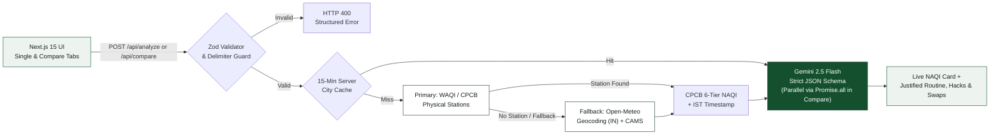

<div align="center">

<!-- Animated Wave Hero Banner -->


<!-- Animated Typewriter Tagline -->
<a href="https://vayuguide.vercel.app">
  
</a>

<br />

<!-- Primary Action & CI Badges -->
<p>
  <a href="https://github.com/titasgarai/vayuguide/actions/workflows/verify.yml">
    
  </a>
  <a href="https://vayuguide.vercel.app">
    
  </a>
  <a href="https://YOUR-PUBLIC-VIDEO-URL">
    
  </a>
  <a href="https://YOUR-LINKEDIN-POST-URL">
    
  </a>
</p>

<!-- Tech Stack Pills -->
<p>
  
  
  
  
  
  
</p>

<!-- Quick-Jump Navigation -->
<p>
  <a href="#-evaluator-quick-test-guide">Quick Test</a> &nbsp;•&nbsp;
  <a href="#-interactive-architecture">Architecture</a> &nbsp;•&nbsp;
  <a href="#-live-verification-snapshot">Live Smoke Results</a> &nbsp;•&nbsp;
  <a href="#-vibe-coding-split--prompt-evolution">Prompt Evolution</a> &nbsp;•&nbsp;
  <a href="#-setup--deployment">Deploy</a>
</p>

</div>

---

> [!TIP]
> **Evaluating VayuGuide?** Open **[vayuguide.vercel.app](https://vayuguide.vercel.app)**, click the **Delhi · Parent (2 Kids)** 1-click preset to see live CPCB telemetry with IST timestamps, then switch to the **Compare Two Personas** tab to watch two tailored Gemini plans generate side-by-side from the exact same station reading.

## Why VayuGuide?

Standard AQI apps stop at a scary red number. VayuGuide translates **verified, real-time Indian station telemetry** into calm, persona-specific daily routines—explaining **why** every recommendation matters for your household alongside zero-cost indoor air hacks and low-emission swaps.

| Capability | How VayuGuide Delivers It |
| :--- | :--- |
| **Zero Dummy / Guessed Data** | Live NAQI, PM2.5, and PM10 readings originate strictly from `src/backend/services/aqi.service.ts` with station name and **IST timestamp** attribution. |
| **Pan-India Coverage** | Queries **WAQI / CPCB physical stations** first (e.g., Delhi, Kolkata) and falls back automatically to **Open-Meteo CAMS** (prioritizing `country_code: IN`) for non-metro towns like Malda. |
| **Side-by-Side Persona Compare** | Dedicated `/api/compare` endpoint fetches live telemetry **once** and runs two **Gemini 2.5 Flash** calls concurrently (`Promise.all`) for instant visual comparison. |
| **Production Hardening** | Protected by Zod payload validation, prompt-injection delimiters, GitHub Actions CI (`lint`, `typecheck`, `vitest`, `build`), `maxDuration = 60s`, and encrypted Vercel Production Secrets. |

---

## ⚡ Evaluator Quick-Test Guide

### 1. 60-Second UI Walkthrough
1. **Single Household Plan:** Click **Delhi · Parent (2 Kids)**, **Kolkata · Daily Commuter**, or **Mumbai · Senior Citizen** to verify live NAQI badges, station sources, IST timestamps, and mandatory **"Why"** callouts.
2. **Side-by-Side Persona Compare:** Open the **Compare Two Personas** tab and click **Compare Side-by-Side** (*Delhi: Parent vs. Daily Commuter*) to inspect two distinct plans grounded in identical station readings.
3. **Pan-India Non-Metro Fallback:** Return to **Single Household Plan**, enter **Malda** (or any Indian town), pick **Senior Citizen**, toggle **HEPA air purifier**, and submit to verify Open-Meteo CAMS fallback and purifier-specific hacks.

<details>
<summary><strong>Click to expand: Copy-paste live <code>curl</code> verification commands</strong></summary>

<br />

```bash
# 1. Single Household Plan (Delhi — Parent, no air purifier)
curl -X POST https://vayuguide.vercel.app/api/analyze \
  -H "Content-Type: application/json" \
  -d '{"city":"Delhi","persona":"parent","hasAirPurifier":false,"plannedActivity":"Evening outdoor park play at 5 PM"}'

# 2. Side-by-Side Persona Compare (Delhi — Parent vs. Daily Commuter)
curl -X POST https://vayuguide.vercel.app/api/compare \
  -H "Content-Type: application/json" \
  -d '{"city":"Delhi","profileA":{"persona":"parent","hasAirPurifier":false,"plannedActivity":"Evening park play at 5 PM"},"profileB":{"persona":"commuter","hasAirPurifier":false,"plannedActivity":"Morning office commute by two-wheeler"}}'
```

</details>

---

## 🧭 Interactive Architecture



<details>
<summary><strong>Click to expand: Clean modular directory tree</strong></summary>

```text
vayuguide/
├── .github/workflows/verify.yml          # CI: ESLint, TypeScript, Vitest, Production Build
├── docs/                                 # Engineering plan, agent rules, design tokens, asset guide
├── scripts/                              # Automated 6-point live endpoint smoke test
├── src/
│   ├── app/                              # Next.js 15 App Router pages & thin API routes (maxDuration = 60)
│   ├── backend/
│   │   ├── services/aqi.service.ts       # Dual-source WAQI/Open-Meteo pipeline + 15-min cache + CPCB NAQI
│   │   ├── services/gemini.service.ts    # Gemini 2.5 Flash client with strict responseSchema JSON output
│   │   └── validators/schemas.ts         # Zod runtime payload schemas
│   ├── frontend/components/              # Editorial UI components (pangram.com-inspired design system)
│   └── shared/types/aqi.ts               # Shared TypeScript contracts
├── tests/                                # Vitest unit & route handler tests (aqi.test.ts, compare.test.ts)
└── Dockerfile                            # Optional multi-stage Node 20 standalone container
```

</details>

---

## ✅ Live Verification Snapshot

All **11 unit tests** (`npm run verify`) and **6 live production smoke checks** (`npm run smoke -- https://vayuguide.vercel.app`) pass:

| Check | Endpoint | Live Verified Result | Status |
| :--- | :--- | :--- | :---: |
| **UI Reachability** | `GET /` | Renders `VayuGuide` editorial interface (`HTTP 200`) | PASS |
| **Delhi (Parent)** | `POST /api/analyze` | `NAQI 340 (Very Poor)` · WAQI / CPCB Live Station Feed · IST | PASS |
| **Kolkata (Commuter)** | `POST /api/analyze` | `NAQI 64 (Satisfactory)` · WAQI / CPCB Live Station Feed · IST | PASS |
| **Malda (Fallback)** | `POST /api/analyze` | `NAQI 79 (Satisfactory)` · Open-Meteo CAMS Fallback · IST | PASS |
| **Persona Compare** | `POST /api/compare` | Shared `Delhi NAQI 340` · Distinct Parent vs. Commuter plans | PASS |
| **Zod Input Guard** | `POST /api/analyze` | Rejects invalid persona enum with clean `HTTP 400` | PASS |

---

## 🧠 Vibe Coding Split & Prompt Evolution

| Layer | Handled By | Scope |
| :--- | :--- | :--- |
| **AI Synthesis & Scaffolding** | **Gemini 2.5 Flash + Antigravity IDE** | Persona-tailored Morning/Afternoon/Evening routines, purifier-aware indoor hacks, sustainable swaps with direct impact, and modular UI scaffolding from `docs/DESIGN.md`. |
| **Deterministic Backend & Ops** | **Custom Engineering** | Dual-source WAQI-to-Open-Meteo fallback, 15-minute server cache, 6-tier Indian CPCB NAQI banding, Zod validation, parallel `/api/compare` orchestration, Vitest + live smoke tests, GitHub Actions CI, and encrypted Vercel production secrets. |

<details>
<summary><strong>Click to expand: How the prompts evolved (v1 → v3)</strong></summary>

1. **v1 (Baseline):** Prompted the model directly with city names. *Issue:* Generic tips and occasional hallucinated AQI numbers.
2. **v2 (Telemetry & Persona Grounding):** Injected verified live station JSON alongside household profile (*Parent, Daily Commuter, Senior Citizen, Student*), planned activity, and HEPA air purifier status.
3. **v3 (Production Schema & Safety):** Locked Gemini output via strict `responseSchema` across three pillars (**Routine Planner**, **Indoor Air Hacks**, **Sustainable Swaps**), enforcing non-empty **`why` / `direct_impact`** scientific justifications and prompt-injection delimiters.

</details>

---

## 🚀 Setup & Deployment

<details>
<summary><strong>Click to expand: Local development & automated verification</strong></summary>

```bash
# 1. Install dependencies (Node.js 20+)
npm install

# 2. Configure local environment (never commit .env.local)
cp .env.example .env.local
# Add GEMINI_API_KEY (required) and WAQI_API_TOKEN (optional; auto-falls back to Open-Meteo)

# 3. Run full verification gate (ESLint, tsc --noEmit, Vitest, Next.js build)
npm run verify

# 4. Run locally and execute the 6-point live smoke test
npm run dev
npm run smoke -- http://localhost:3000
```

</details>

<details>
<summary><strong>Click to expand: Production deployment (Vercel Primary + Optional Docker / Cloud Run)</strong></summary>

#### Primary: Vercel Production (Live at `vayuguide.vercel.app`)
Both `/api/analyze` and `/api/compare` export `maxDuration = 60`, and secrets are stored exclusively as encrypted **Vercel Production Environment Secrets**:

```bash
npx vercel link --yes --project vayuguide
printf '%s' 'YOUR_GEMINI_API_KEY' | npx vercel env add GEMINI_API_KEY production
printf '%s' 'YOUR_WAQI_API_TOKEN' | npx vercel env add WAQI_API_TOKEN production
npx vercel --prod --yes
npm run smoke -- https://vayuguide.vercel.app
```

#### Optional: Container Deployment (Docker / Google Cloud Run)
Includes a multi-stage standalone Next.js 15 `Dockerfile` listening on `PORT=8080`:

```bash
gcloud run deploy vayuguide \
  --source . \
  --region asia-south1 \
  --port 8080 \
  --memory 512Mi \
  --allow-unauthenticated \
  --set-secrets="GEMINI_API_KEY=GEMINI_API_KEY:latest,WAQI_API_TOKEN=WAQI_API_TOKEN:latest"
```

</details>

---

<div align="center">
  <sub>Built by <strong>Titas Garai</strong> for <strong>PromptWars Virtual · Challenge 6 (Hack2skill)</strong></sub>
  <br />
  
</div>
